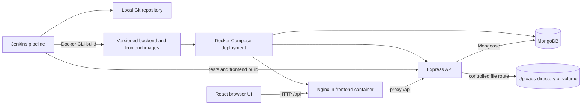
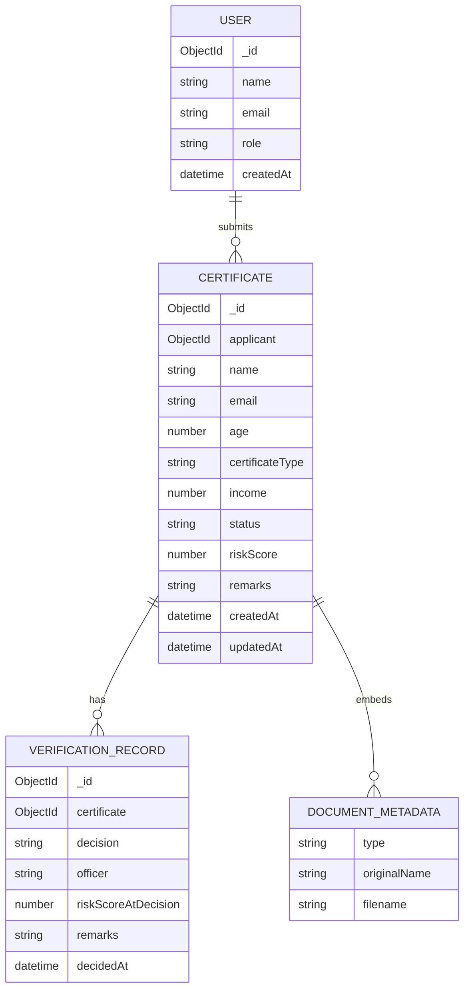
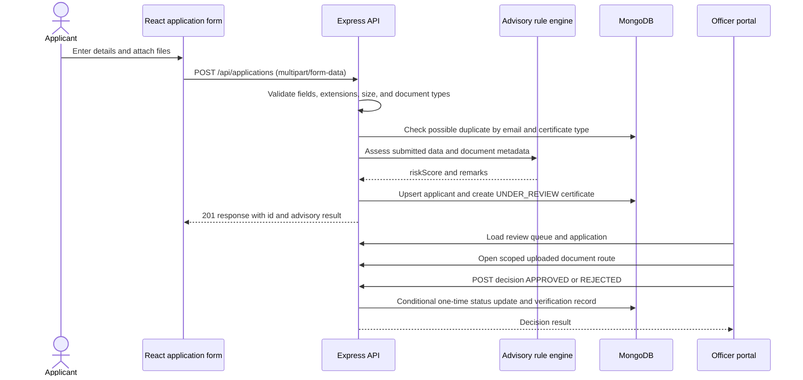

# System Design Document
## Certificate Automation and Verification System

**Version:** Draft 1.0  
**Status date:** 21 October 2026  
**Team:** V.Harish Kumar (24MIS0031); M.Leela Avinash (24MIS0198); S.H.Sheik Fareed (24MIS0262)

## 1. Architecture

The browser application calls the Express API. The API validates requests, applies the advisory rule engine, stores account/application/history data in MongoDB, and keeps uploaded files in local or Docker-volume storage. Nginx serves the built frontend and forwards /api requests to the backend in the Compose deployment.

The architecture diagram describes the implemented local demo. Jenkins checkout uses a local file URL on this workstation. Authentication and external government systems are not present.

## 2. Component responsibilities

| Component | Responsibility |
|---|---|
| React/Vite frontend | Role selection, application form, officer queue/detail/history, read-only admin overview |
| Express app | CORS/JSON middleware, health endpoint, route mounting |
| Application routes | Certificate configuration endpoint, multipart upload, server-side field/file checks, duplicate query, applicant upsert, application persistence |
| Certificate configuration | Single source of truth for supported certificate types, document types, and income-dependent types |
| Rule engine | Advisory score and remarks only; no approve/reject behavior |
| Officer routes | Queue, application details, scoped file response, one-time decision, history retrieval |
| Admin routes | Read-only user and rule overview |
| Mongoose models | Users, certificates/applications, verification records |
| MongoDB | Persistent document collections |
| Nginx | Static frontend and /api reverse proxy in container deployment |
| Jenkins | SCM checkout, install, backend test, frontend build, Docker image build |
| Docker Compose | Local MongoDB, backend, frontend, and persistent volumes |

## 3. Data model

Collection names are users, certificates, and verificationrecords. Document metadata is embedded in each certificate document; uploaded file bytes are stored separately. VerificationRecord references a certificate. The officer name stored by the demo is “Local demo officer (unverified)”; it is not an authenticated identity.

## 4. Main request sequence

If verification-record creation fails after status update, the route attempts to restore UNDER_REVIEW status and returns an error. A later decision attempt after a completed decision returns HTTP 409.

## 5. API contract

Base path is /api. JSON routes return JSON unless a document route returns a file.

| Method | Path | Purpose |
|---|---|---|
| GET | /api/health | Backend health |
| GET | /api/certificate-types | Certificate types, required documents, income-dependent types |
| POST | /api/applications | Multipart application submission; success 201, validation failure 400 |
| GET | /api/officer/review-queue | UNDER_REVIEW applications |
| GET | /api/officer/history | Decision records, newest first |
| GET | /api/officer/applications/:id | One application and document metadata |
| GET | /api/officer/applications/:id/documents/:filename | Opens a file only if linked to that application |
| POST | /api/officer/applications/:id/decision | Body decision APPROVED or REJECTED; repeat/locked decision 409 |
| GET | /api/admin/overview | Read-only accounts, certificate config, and advisory rule configuration |

Submission multipart fields: name, email, age, certificateType; income for Income/EWS; repeated documentTypes fields paired with documents files. Accepted filename extensions are PDF, JPG, JPEG, PNG; maximum five files, 5 MB each.

## 6. Deployment configuration

Docker Compose defines MongoDB 8.0, backend, and Nginx frontend services. Host mappings are 27018:27017, 5001:5000, and 8081:80. MongoDB data and backend uploads use named volumes. The frontend build argument sets VITE_API_URL to /api, which Nginx proxies to the backend service.

Environment variables: backend PORT and MONGO_URI. The committed .env.example is for local development; real .env files are excluded from Git. The Compose database is a local demo database without configured authentication.

