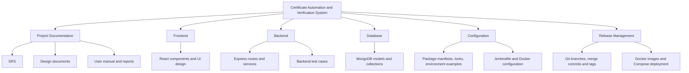

# SCM Configuration Records
## Certificate Automation and Verification System

**Version:** Draft 1.0  
**Status date:** 21 October 2026  
**Team:** V.Harish Kumar (24MIS0031); M.Leela Avinash (24MIS0198); S.H.Sheik Fareed (24MIS0262)

## 1. Configuration-item hierarchy

Review-I page 7 contains a hierarchy diagram. The diagram’s top-level branches are reproduced below; the register that follows expands them to the eight CIs listed in Review-I.

## 2. Master CI register and CSA

Status definitions: **Released** means included in an annotated release tag; **Candidate** means present on the current feature branch and verified but not merged/tagged as the next release; **Draft** means documentation or formal approval is incomplete.

| CI ID | Review-I configuration item | Contents / repository location | Current version/status | Owner role |
|---|---|---|---|---|
| CI-01 | Project Documentation | SRS, design, user manual, SCM records, audit/test report under documentation/ | Draft 1.0; prepared for v1.3 candidate | Technical Writer |
| CI-02 | Source Code | frontend/src; backend/app.js, routes, models, services | v1.2.0 released baseline; v1.3 candidate on feature/docker-jenkins-admin | Developer |
| CI-03 | Database | Mongoose models; users, certificates, verificationrecords | v1.2.0 released schema; v1.3 candidate | Database Administrator |
| CI-04 | Configuration Files | package manifests/locks, .env.example, .gitignore, Dockerfiles, Nginx, Compose, Jenkinsfile | v1.3 candidate | Developer |
| CI-05 | Test Cases | backend/tests and Jenkins test execution | 32 tests pass in latest successful Jenkins run | Tester |
| CI-06 | UI Design | React page components and CSS; no separate wireframe files found | Implemented UI; formal design approval not recorded | System Designer |
| CI-07 | Release Versions | Annotated tags v1.0.0, v1.1.0, v1.2.0; Docker image tags | v1.2.0 released; v1.3.0 images built but release tag pending | Release Manager |
| CI-08 | Git Repository | Branches, commits, merge history and tags | Active feature branch; v1.3 changes not yet merged to develop/main | Configuration Manager |

Review-II’s six-row CSA separated SRS, Design Document, and User Manual, while Review-I groups them under Project Documentation and separately lists configuration files, UI design, release versions, and Git Repository. This register uses Review-I’s eight categories and maps the Review-II artifacts into them; the original review documents are not altered.

## 3. Change-request register and reconciliation

The Review-II table is a snapshot, not a current implementation report. Its entries recorded CR-01 Completed, CR-02 and CR-03 In progress, and CR-04 and CR-05 Not started. Its status report says three open changes, although four entries were not complete in the table. Its summary reports one completed, two in progress, and two pending. Those historical figures are preserved here as the Review-II snapshot.

| ID | Change request | Review-II snapshot | Current implementation evidence (21 Oct 2026) | CCB evidence |
|---|---|---|---|---|
| CR-01 | Modify certificate application form | High; Approved; Completed | Implemented in user portal; v1.0.0 release | Review-II reports Approved; meeting minutes not located |
| CR-02 | Add document validation | High; Approved; In progress | Implemented: field/file checks, type pairing; missing required documents are advisory findings | Review-II reports Approved; meeting minutes not located |
| CR-03 | Improve rule-engine risk assessment | High; Approved; In progress | Implemented in ruleEngine.js; v1.1.0/v1.2.0 releases | Review-II reports Approved; meeting minutes not located |
| CR-04 | Add decision-history enhancement | Medium; Pending; Not started | Implemented in v1.2.0; history API, model, and page | Review-II records Pending; later formal CCB approval not evidenced |
| CR-05 | Change UI theme/layout | Low; Pending; Not started | Styled responsive portal is present in frontend; no separate CR commit identified | Review-II records Pending; later formal CCB approval not evidenced |

**Current implementation summary:** 5 of 5 requested changes have implementation evidence in the current repository; 0 remain technically in progress; 0 are unimplemented. This does not claim that all five received a formally recorded CCB approval. The Git merge history proves integration, not a CCB meeting or approval. Before formal submission, the team should add actual CCB decisions if they occurred.

## 4. Release and baseline register

| Release | Baseline | Contents | Git status as of 21 Oct 2026 |
|---|---|---|---|
| Release 1 | v1.0.0 | User application, certificate selection, document upload | Annotated tag exists on main |
| Release 2 | v1.1.0 | Advisory rules, officer review queue, documents, approve/reject | Annotated tag exists on main |
| Release 3 | v1.2.0 | Risk scoring and decision history | Annotated tag exists on main |
| Release 4 | v1.3.0 | Read-only admin overview, Docker Compose, Jenkins pipeline, final documentation | Candidate only; images built successfully; merge and annotated tag not yet made |

Docker image tags certificate-backend:v1.3.0 and certificate-frontend:v1.3.0 identify candidate build images. Image tags do not by themselves mean the Git release v1.3.0 has been approved or tagged.

## 5. Configuration status accounting report

| Measure | Review-II snapshot | Current repository status |
|---|---:|---|
| CIs tracked | 6 CSA rows | 8 canonical Review-I CIs, with Review-II artifacts mapped into them |
| Approved / released | 4 in Review-II’s v1.2 report | v1.0.0, v1.1.0, and v1.2.0 are Git-tagged releases; formal CCB status is separately recorded |
| Under review or draft | 2 in Review-II | Documentation in this set is Draft 1.0 pending team review; v1.3 is not released |
| Open changes | 3 in Review-II status report | 0 technically unimplemented requests; formal CCB record for CR-04/05 is missing |
| Total change requests | 5 | 5 implemented in current code; see reconciliation above |

## 6. CCB decision log

No dated CCB minutes, attendee list, or signed decision record was found in the repository during this audit. Review-II reports CCB approval for CR-01 to CR-03 and pending approval for CR-04/CR-05 at that review. Branch merges and release tags are technical SCM evidence, not proof of a CCB decision. This log therefore records the evidence gap rather than inventing meeting dates or votes.

| Date | Item | Recorded outcome | Evidence |
|---|---|---|---|
| — | CR-01 through CR-05 | No separate CCB meeting record available in repository | Review-II snapshot and Git history; neither substitutes for minutes |

## 7. SCM process and CMMI practice mapping

| Practice | Application to this project | Evidence / current gap |
|---|---|---|
| Identify configuration items | Name and track the eight Review-I CI categories | Master CI register above |
| Establish a configuration management system | Use Git for history, branches, merges, and tags | Local Git repository and feature/develop/main flow |
| Create or release baselines | Annotated tags identify v1.0.0, v1.1.0, v1.2.0 | v1.3.0 remains a candidate |
| Track change requests | Map Review-II’s five requests to implementation evidence | Register above; no issue tracker is configured |
| Control configuration items | Integrate through feature branches and no-fast-forward merges | Git log; formal CCB minutes are a separate missing record |
| Establish configuration records | Maintain CSA, release, status, and change records | This document is Draft 1.0 |
| Perform configuration audits | Compare requirements, test output, tags, images, and manuals | See verification-and-audit.md; formal signoff remains open |

## 8. SCM automation

| Tool | Actual use | Evidence |
|---|---|---|
| Git | Feature branches, conventional commits, no-fast-forward merges, annotated release tags | Repository history; v1.0.0–v1.2.0 tags |
| Jenkins | Polls the local Git SCM; installs dependencies; runs backend tests; builds frontend; builds two Docker images | Successful run on commit 95c8f40; six suites, 32 tests |
| Docker | Builds versioned backend and frontend images; Compose runs MongoDB, API, and UI | Successful Jenkins Docker build and owner-confirmed Compose demonstration |

The Jenkins pipeline currently includes this workstation’s Docker CLI folder and reads a local file URL. These settings are suitable only for this local demonstration unless replaced with portable agent/tool configuration and a remote SCM URL.

